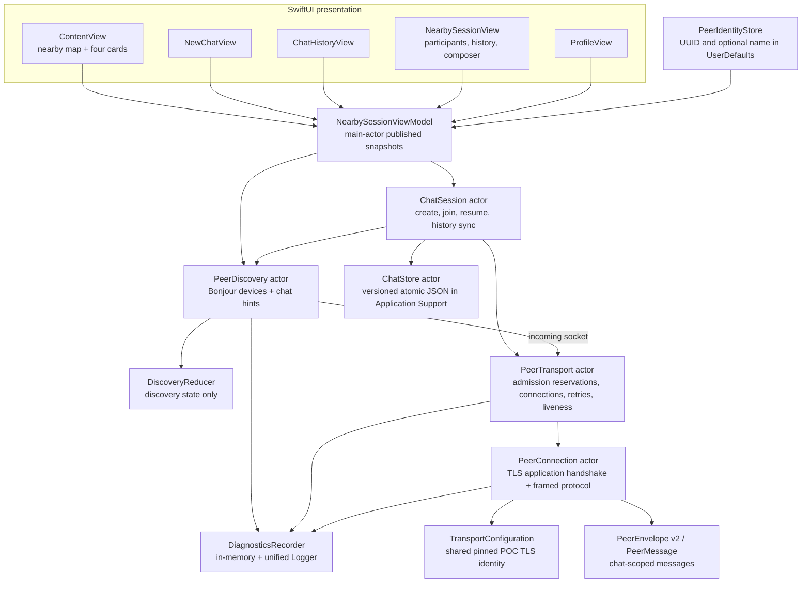

# Subway Lore system diagrams

These diagrams describe the chat-ID-based PoC. Games remain Coming Soon. There is no central server or permanent chat host.

## 1. Project components



The landing page only browses/advertises. New Chat creates an ID; a live row joins an existing ID; History previews saved messages without joining. Join / Resume explicitly reactivates that saved ID.

## 2. Device and live-chat discovery

```mermaid
sequenceDiagram
    autonumber
    participant UI as Landing page
    participant VM as View model
    participant PD as PeerDiscovery
    participant Bonjour as Bonjour network
    participant Session as ChatSession

    UI->>VM: start
    VM->>PD: start listener and browser
    PD->>Bonjour: advertise peer UUID, name, protocol version
    Bonjour-->>PD: currently visible endpoints and TXT records
    PD->>PD: filter self / invalid identities, deduplicate endpoints
    PD-->>VM: DiscoverySnapshot
    VM-->>UI: nearby rider nodes, no connection edges

    UI->>Session: create or join chat
    Session->>Session: select stable chat ID
    Note over Session: New chat is stored immediately; joining stores membership after admission
    Session->>PD: advertise admitted chat ID and title
    PD->>Bonjour: refresh local service advertisement
    Bonjour-->>PD: remote participants advertise the same chat ID
    PD-->>VM: peers with chat hints
    VM->>VM: aggregate by chat ID
    VM-->>UI: one live row per chat, at most 3 rows

    UI->>Session: leave chat
    Session->>PD: remove chat fields, keep device discovery
    Note over UI,Session: Other participants continue advertising; local history remains
```

Live/inactive describes nearby observations. Missing advertisements do not establish that a chat is empty everywhere. There is no idle-expiration timer.

## 3. Chat admission and reconnection

```mermaid
sequenceDiagram
    autonumber
    participant C as Returning rider C
    participant A as Participant A
    participant B as Participant B

    Note over A,B: A and B advertise chat X
    C->>C: open saved chat X and select Join / Resume
    C->>A: establish pinned mutually authenticated TLS
    C->>A: hello and helloAccepted
    A->>C: hello and helloAccepted
    C->>A: joinChatRequest for X
    A->>C: joinChatRequest for X
    Note over C,A: Each side checks chat ID and reserves connection capacity
    A->>C: joinChatAccepted with canonical chat metadata
    C->>A: joinChatAccepted
    C->>C: persist membership; advertise X
    C->>B: same admission process for X
    Note over A,C: Keep one accepted connection per UUID; prefer deterministic direction if duplicates race

    loop While chat is open
        C->>A: periodic ping
        A->>C: pong
    end
    A--xC: connection lost
    C->>C: remove only that connection ID; backoff and retry
    C->>A: fresh TLS and admission for the same chat ID
    Note over A,C: Leaving invalidates the session generation and cancels retries
```

A valid first connection can use either direction, so the higher UUID can initiate admission. If simultaneous duplicate connections exist, both devices prefer the lower UUID's outgoing direction.

There are at most eight distinct reserved/connected remote peers per device, with a separate bounded allowance for unidentified inbound handshakes. Admission times out after 15 seconds; retries use exponential delay and jitter capped near 30 seconds. Pings run about every 10 seconds; an unresponsive accepted connection is removed after about 35 seconds.

## 4. Messages and missed-history synchronization

```mermaid
sequenceDiagram
    autonumber
    participant C as Returning rider C
    participant Local as C ChatStore
    participant A as Participant A
    participant B as Participant B

    C->>Local: load saved chat X and messages
    Local-->>C: immediate history display
    Note over C,B: TLS and chat admission complete before synchronization
    A->>C: historyInventory pages, up to 100 IDs each
    C->>Local: compare IDs scoped to chat X
    C->>A: historyRequest for missing IDs
    A->>C: historyBatch, one original message per frame
    C->>Local: atomic merge by chat ID and message ID
    A->>C: historyComplete
    B->>C: overlapping history inventory / records
    C->>Local: merge again; existing messages remain single copies

    C->>C: compose message; create one ID and timestamp
    C->>Local: persist before broadcast
    C->>A: chatText with original ID and chat X
    C->>B: same ID, timestamp, and chat X
    Note over C,B: Live reception continues during history transfer
```

A history record retains its original author even when another peer forwards it. The transport sender is checked separately. Conflicting content with an existing message ID is rejected rather than overwriting the original.

Inventory pages request only missing records. Transfers run separately from the receive loop to avoid blocking simultaneous synchronization. Retry asks peers to resend their inventory as well as sending the local inventory. Interrupted requests surface an error after 30 seconds.

## UI and storage behavior

| Entry point | Behavior |
| --- | --- |
| Nearby map | Discovery-only nodes; map height reduced from 210 to 180 points |
| Live Chats | Up to three live rows, automatic admission when tapped |
| History button | Saved joined chats with previews and locally observed live/inactive status |
| Saved chat preview | Read-only history until Join / Resume is selected |
| New Chat | Name form, new UUID, persist and advertise |
| Live Games / New Game | Inactive Coming Soon placeholders |
| Chat back navigation | Close connections and remove own chat advertisement; preserve history |

Chat messages have a chat ID, stable message ID, sender UUID/name, text, and original timestamp. Chats have an immutable ID, title, creation time, and creator attribution. Membership records track which chats this installation joined. Stored data is a versioned JSON document written atomically under Application Support.

## Validation and limitations

- Run Foundation-based unit tests without launching the app: `make test-core`.
- Build the iOS app and tests with the project's usual `xcodebuild build-for-testing` command.
- Three physical devices are needed to validate discovery, TLS, termination/relaunch, full-mesh recovery, and missed-message synchronization end to end.
- All devices must run protocol v2; unscoped v1 clients are incompatible.
- Synchronization can recover only history retained by reachable participants.
- The eight-peer bound is local, not a globally coordinated room-size guarantee. There is no relay beyond direct peers.
- Messages have no delivery receipts yet. Device clocks can differ; ordering uses timestamp and message ID.
- The bundled shared TLS identity is POC material, and historical authorship is not cryptographically proven.
