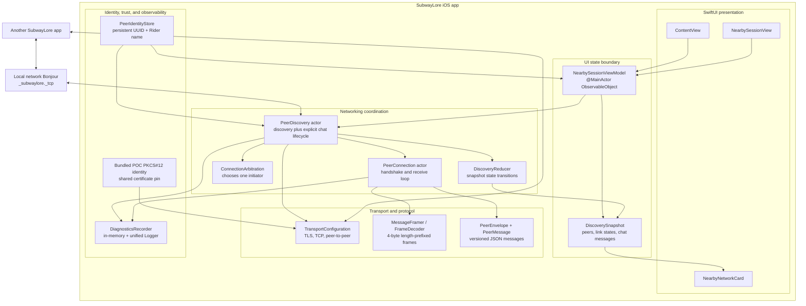
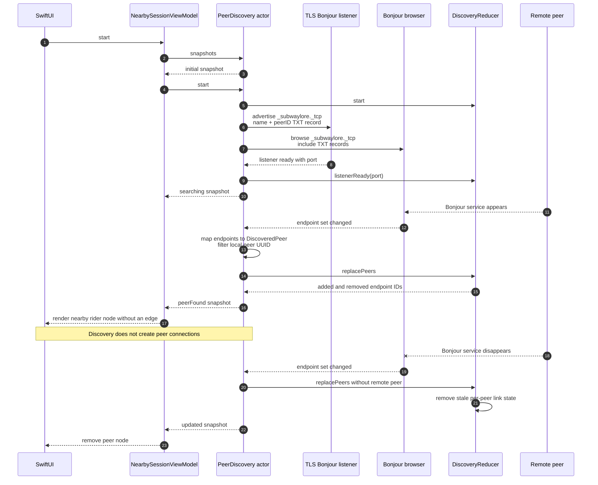
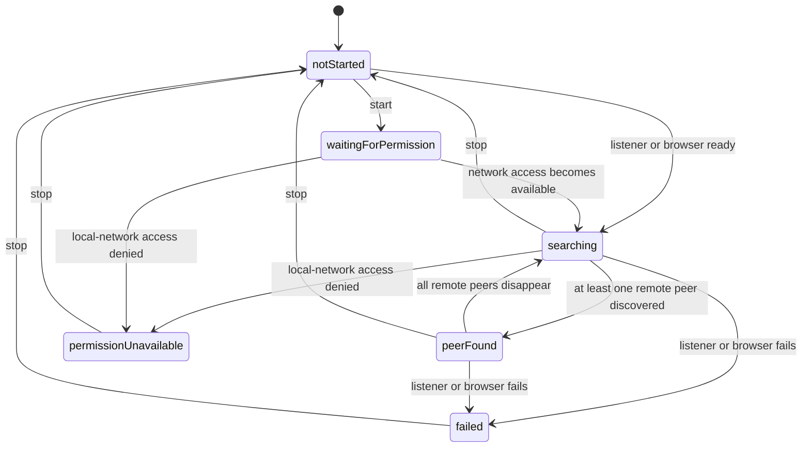
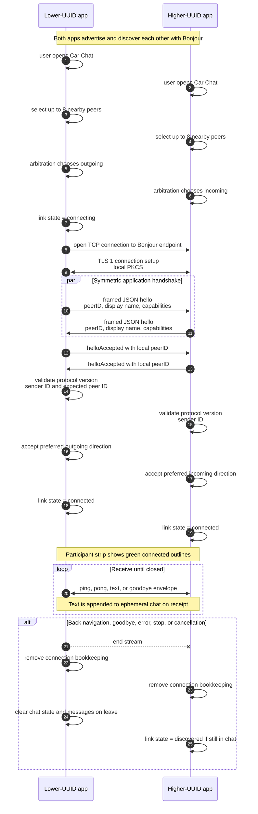
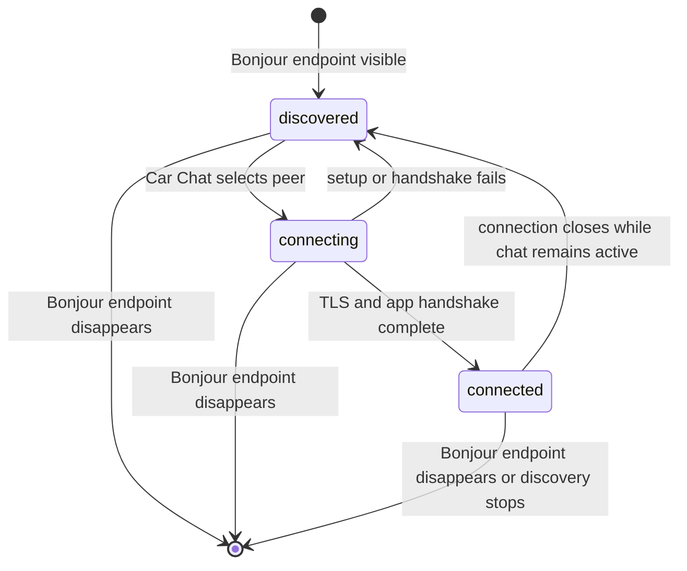

# Subway Lore system diagrams

These diagrams describe the current proof-of-concept implementation. They reflect the code as it exists today, including the parts that are present but not yet exposed as user-facing features.

## 1. Overall project setup

The UI does not call Network framework APIs directly. `NearbySessionViewModel` starts discovery, consumes the `AsyncStream<DiscoverySnapshot>`, and publishes the latest snapshot to SwiftUI. Opening Car Chat calls `joinChat(maximumPeers:)`; leaving it calls `leaveChat()`.

## 2. Peer discovery lifecycle

### Discovery state model

Discovery and connection are deliberately separate. The landing page advertises and browses continuously but does not initiate connections. Per-peer link states change only while Car Chat is active.

## 3. Secure network connection

Opening Car Chat selects at most eight discovered peers and starts connection attempts. Both users must open Car Chat. If both sides create a connection, UUID arbitration keeps the connection whose direction both peers deterministically prefer.

### Per-peer link state and UI

| Link state | Meaning | Current UI |
| --- | --- | --- |
| `discovered` | Bonjour can see the peer, but no secure session is active. | Node on landing page; neutral participant in chat |
| `connecting` | A TLS connection or application handshake is in progress. | Neutral participant plus “Connecting…” |
| `connected` | TLS and the `hello` / `helloAccepted` handshake succeeded. | Green participant outline and connected count |

## Current implementation boundaries

- Discovery, TLS setup, framing, handshake, connection arbitration, bounded chat connections, and text messaging are implemented.
- Car Chat is the explicit connection boundary. Leaving the chat closes connections and clears its in-memory messages while discovery continues.
- Car Game is visible as “Coming soon” and has no navigation or networking behavior.
- Chat messages are sent to currently connected peers only. History is not persisted or synchronized to riders who join later.
- Diagnostics are retained in memory and mirrored to Apple unified logging under subsystem `com.subwaylore.SubwayLore`.
- `ping` and `pong` protocol types exist but currently have no user-facing behavior.
- A failed connection returns to `discovered`; there is no visible per-peer failure state or explicit retry policy.
- The bundled PKCS#12 identity and password are proof-of-concept material. Every installation trusts the same pinned certificate; this is not a production identity or trust design.
