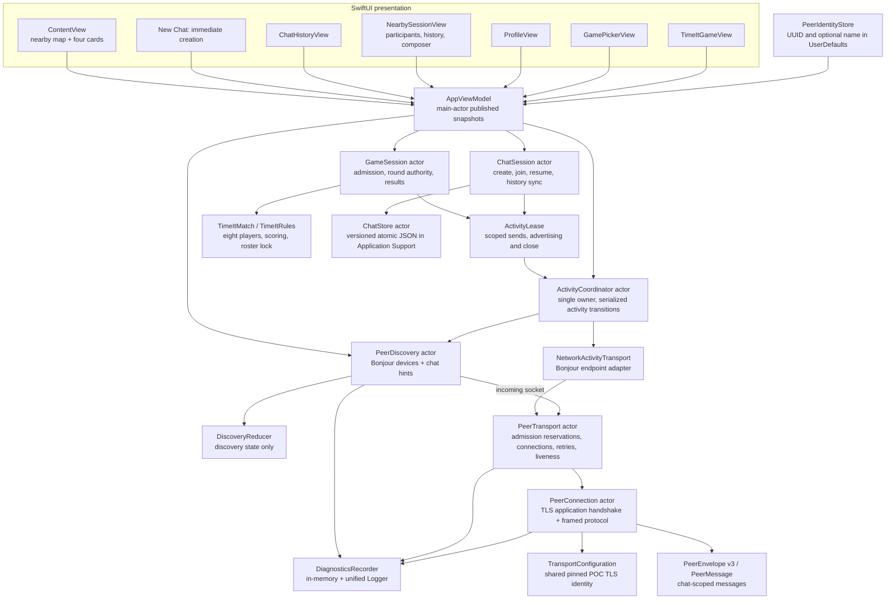
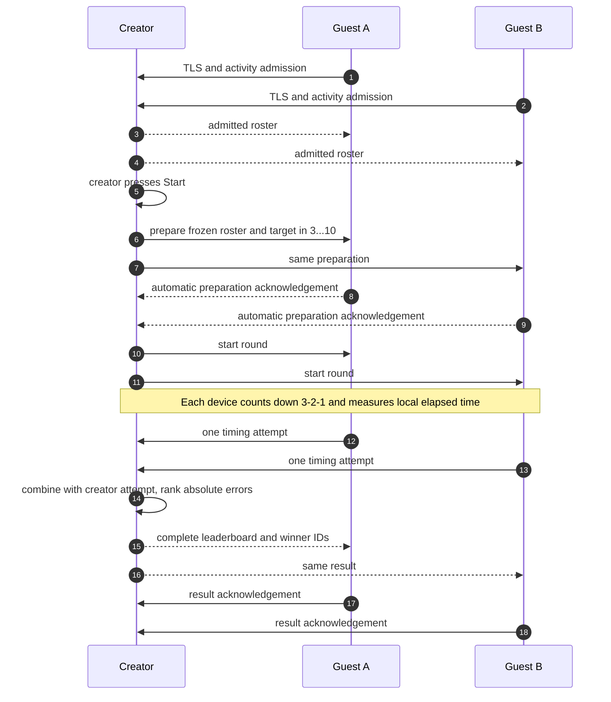

# Subway Lore system diagrams

These diagrams describe nearby chats and the multiplayer Time |t! game. There is no central server or permanent car host; each game creator is the authority for that match.

## 1. Project components



The landing page only browses/advertises. New Chat creates an ID; a live row joins an existing ID; History previews saved messages without joining. Join / Resume explicitly reactivates that saved ID.

## 2. Device and live-chat discovery

```mermaid
sequenceDiagram
    autonumber
    participant UI as Landing page
    participant VM as View model
    participant PD as PeerDiscovery
    participant Bonjour as Bonjour network
    participant Session as ChatSession

    UI->>VM: start
    VM->>PD: start listener and browser
    PD->>Bonjour: advertise peer UUID, name, protocol version
    Bonjour-->>PD: currently visible endpoints and TXT records
    PD->>PD: filter self / invalid identities, deduplicate endpoints
    PD-->>VM: DiscoverySnapshot
    VM-->>UI: nearby rider nodes, no connection edges

    UI->>Session: create or join chat
    Session->>Session: select stable chat ID
    Note over Session: New chat is stored immediately; joining stores membership after admission
    Session->>PD: advertise admitted chat ID and title
    PD->>Bonjour: refresh local service advertisement
    Bonjour-->>PD: remote participants advertise the same chat ID
    PD-->>VM: peers with chat hints
    VM->>VM: aggregate by chat ID
    VM-->>UI: one live row per chat, at most 3 rows

    UI->>Session: leave chat
    Session->>PD: remove chat fields, keep device discovery
    Note over UI,Session: Other participants continue advertising; local history remains
```

Live/inactive describes nearby observations. Missing advertisements do not establish that a chat is empty everywhere. There is no idle-expiration timer.

## 3. Chat admission and reconnection

```mermaid
sequenceDiagram
    autonumber
    participant C as Returning rider C
    participant A as Participant A
    participant B as Participant B

    Note over A,B: A and B advertise chat X
    C->>C: open saved chat X and select Join / Resume
    C->>A: establish pinned mutually authenticated TLS
    C->>A: hello and helloAccepted
    A->>C: hello and helloAccepted
    C->>A: joinActivityRequest for X
    A->>C: joinActivityRequest for X
    Note over C,A: Each side checks chat ID and reserves connection capacity
    A->>C: joinActivityAccepted with canonical chat metadata
    C->>A: joinActivityAccepted
    C->>C: persist membership; advertise X
    C->>B: same admission process for X
    Note over A,C: Keep one accepted connection per UUID; prefer deterministic direction if duplicates race

    loop While chat is open
        C->>A: periodic ping
        A->>C: pong
    end
    A--xC: connection lost
    C->>C: remove only that connection ID; backoff and retry
    C->>A: fresh TLS and admission for the same chat ID
    Note over A,C: Leaving invalidates the session generation and cancels retries
```

A valid first connection can use either direction, so the higher UUID can initiate admission. If simultaneous duplicate connections exist, both devices prefer the lower UUID's outgoing direction.

There are at most eight distinct reserved/connected remote peers per device, with a separate bounded allowance for unidentified inbound handshakes. Admission times out after 15 seconds; retries use exponential delay and jitter capped near 30 seconds. Pings run about every 10 seconds; an unresponsive accepted connection is removed after about 35 seconds.

## 4. Messages and missed-history synchronization

```mermaid
sequenceDiagram
    autonumber
    participant C as Returning rider C
    participant Local as C ChatStore
    participant A as Participant A
    participant B as Participant B

    C->>Local: load saved chat X and messages
    Local-->>C: immediate history display
    Note over C,B: TLS and chat admission complete before synchronization
    A->>C: historyInventory pages, up to 100 IDs each
    C->>Local: compare IDs scoped to chat X
    C->>A: historyRequest for missing IDs
    A->>C: historyBatch, one original message per frame
    C->>Local: atomic merge by chat ID and message ID
    A->>C: historyComplete
    B->>C: overlapping history inventory / records
    C->>Local: merge again; existing messages remain single copies

    C->>C: compose message; create one ID and timestamp
    C->>Local: persist before broadcast
    C->>A: chatText with original ID and chat X
    C->>B: same ID, timestamp, and chat X
    Note over C,B: Live reception continues during history transfer
```

A history record retains its original author even when another peer forwards it. The transport sender is checked separately. Conflicting content with an existing message ID is rejected rather than overwriting the original.

Inventory pages request only missing records. Transfers run separately from the receive loop to avoid blocking simultaneous synchronization. Retry asks peers to resend their inventory as well as sending the local inventory. Interrupted requests surface an error after 30 seconds.

## UI and storage behavior

| Entry point | Behavior |
| --- | --- |
| Nearby map | Discovery-only nodes; map height reduced from 210 to 180 points |
| Live Chats | Up to three live rows, automatic admission when tapped |
| History button | Saved joined chats with previews and locally observed live/inactive status |
| Saved chat preview | Read-only history until Join / Resume is selected |
| New Chat | Open immediately with a new UUID; initially creator’s first name or “New chat,” then a first-message excerpt |
| Live Games | Up to three waiting/playing games, with count and availability |
| New Game | Themed game-picker sheet; Time &#124;t! creates an eight-player lobby |
| Game screen | Creator Start, local countdown/hidden timer, Stop, results and next round |
| Chat back navigation | Close connections and remove own chat advertisement; preserve history |

Chat messages have a chat ID, stable message ID, sender UUID/name, text, and original timestamp. Chats have an immutable ID, initial fallback title, creation time, and creator attribution. The displayed title is derived from the first message (timestamp, then message ID), normalized to one line and limited to 40 characters and 240 UTF-8 bytes for Bonjour. Later messages update the separate history preview, not the title. Synchronizing an earlier message can reconcile the first-message title across devices. Membership records track which chats this installation joined. Stored data is a versioned JSON document written atomically under Application Support.

## 5. Time |t! multiplayer game

Games use a star, independently of chat's mesh. Eight total players means the creator has at most seven guest connections; each guest connects only to the creator.



Only the creator advertises a game lobby. Admission reserves a seat before accepting it, and Start is disabled until at least two players are connected and pending reservations are resolved. Joins are closed during a round. The creator may start another round from the results screen; guests may join between rounds.

Every player measures their own interval with a monotonic clock, so packet latency is not added to the attempt. One accepted attempt per player is immutable. Equal smallest millisecond errors produce joint winners. Players time out after 20 seconds; the creator allows two seconds of transport grace before forfeiting missing records. A guest departure preserves an already accepted attempt or creates a forfeit, while other players continue. Creator departure/backgrounding ends the game.

Preparation has a 10-second acknowledgement deadline. Results retry at two-second intervals up to five times. Guests have a bounded result-wait deadline. Stale round/session IDs cannot change a new game, and game packets are isolated from chat history.

## Validation and limitations

- ActivityCoordinator owns the shared transport. Chat/game sessions hold scoped leases; cleanup or a callback from an old activity cannot close or write to a replacement activity.
- Chat membership is derived from session state. Creator game snapshots are projected from TimeItMatch, including round, phase, attempts, outcome and participants; round-start status is derived from phase.
- ChatSession and GameSession run in the core test package using a fake ActivityTransport and ManualSessionClock. Lifecycle tests cover concurrent opens, stale callbacks/leases, real game round completion, timeouts, send failures, and history-task cancellation.
- Session deadlines/transfers are cancelled on leave. The production adapter supplies Bonjour endpoints; tests require neither Network.framework connections nor Simulator.

- Run Foundation-based unit tests without launching the app: `make test-core`.
- Build the iOS app and tests with the project's usual `xcodebuild build-for-testing` command.
- Physical devices are needed to validate discovery, TLS, chat recovery, game timing interactions, simultaneous joins, and backgrounding end to end.
- All devices must run protocol v3 for activity-scoped admission and games; older clients are incompatible.
- Synchronization can recover only history retained by reachable participants.
- The eight-peer bound is local, not a globally coordinated room-size guarantee. There is no relay beyond direct peers.
- Messages have no delivery receipts yet. Device clocks can differ; ordering uses timestamp and message ID.
- The bundled shared TLS identity is POC material, and historical authorship is not cryptographically proven.
