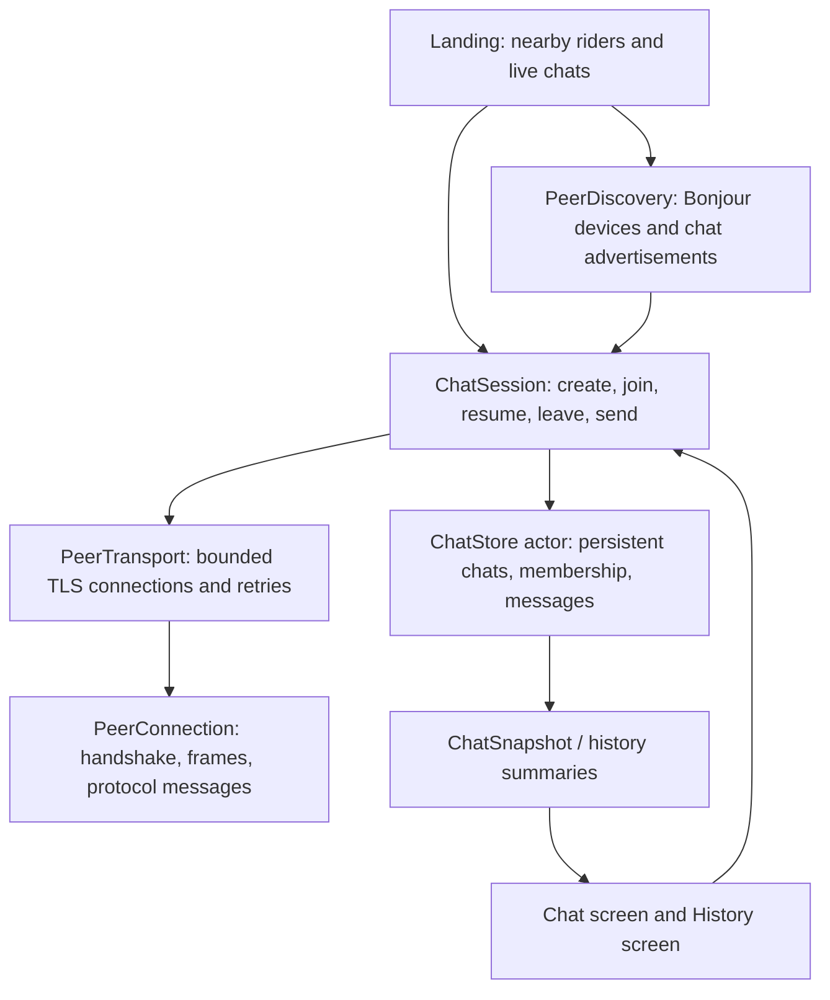

# Subway Lore PoC — Chats, Reconnection, and Local History

## Objective and agreed behavior

Give conversations a persistent identity independent of devices and connections. A returning rider rejoins the same chat, restores locally saved messages, and retrieves missed messages from available participants.

This evolves the earlier implicit-chat proposal: users can now discover multiple live chats, create a chat, or resume a saved chat. There is still no central backend or permanent chat owner.

- Admission is automatic, subject to compatibility and connection capacity.
- A chat is live locally when at least one nearby participant advertises it. Otherwise it is inactive locally.
- There is no idle expiration timer. Inactivity does not delete a chat or make it read-only.
- Each device stores only chats it created or joined and messages it sent, received, or synchronized after joining.
- Leaving closes chat connections and stops advertising participation, but preserves history.
- Resuming a chat preserves its chat ID; only New Chat creates a new ID.
- One device participates in at most one open chat at a time for this PoC.
- Games remain Coming Soon. No gameplay or game discovery is implemented in this plan.

## Current foundation and gaps

The app already has persistent peer UUIDs, optional first/last-name profiles, Bonjour device discovery, TLS, framed JSON, connection arbitration, and a basic chat screen. A message now keeps the same ID and timestamp on the sender and all recipients.

There is no `Chat` model or chat ID on messages. Chat messages live in `DiscoverySnapshot`; leaving clears them. Connection attempts are driven primarily by joining and endpoint changes, with no reliable retry schedule. Nearby peers and joined participants are not separate concepts yet.

## New and revised models

Keep stored domain models, live network observations, and UI snapshots separate.

| Model | Fields / responsibility | Storage |
| --- | --- | --- |
| `Chat` (new) | `id: UUID`, `title: String`, `createdAt: Date`, `createdByPeerID: UUID` | Persistent |
| `ChatMessage` (revised) | Add `chatID: UUID`; retain `id`, `senderID`, `senderName`, `text`, `sentAt` | Persistent |
| `ChatMembership` (new) | `chatID`, `localPeerID`, `joinedAt`, optional `lastOpenedAt`; proves this device joined rather than merely discovered a chat | Persistent |
| `ChatParticipant` (new) | `chatID`, `peerID`, `displayName`, current connection state | Memory only |
| `DiscoveredChat` (new) | Chat ID/title, set of advertising peer UUIDs, most recent local observation | Memory only |
| `ChatSessionState` (new) | `idle`, `joining(chatID)`, `joined(chatID)`, `leaving(chatID)` | Memory only |
| `ChatSnapshot` (new) | Selected chat, messages, participants, session state, synchronization status, user-visible error | Published to UI |
| `PeerConnectionRecord` (new) | Peer ID, connection ID, lifecycle generation, state, retry attempt, next retry time | Memory only |

Derived values:

- `Chat.lastActivityAt`: latest retained message timestamp, falling back to creation time. This sorts history; it does not expire chats.
- Live/inactive: derived from current advertisements and local participation, never permanently stored as chat truth.
- Connected count: authenticated, admitted remote participants only; label whether the local user is included.
- History preview: latest locally stored message for each joined chat.

Use the chat ID to distinguish conversations with the same title. `createdByPeerID` is attribution, not ownership or a requirement that the creator remain online. Keep chat metadata immutable in this PoC; renaming and shared metadata conflict resolution are later work.

## Component responsibilities

- Move chat state and message handling out of `DiscoveryReducer` / `DiscoverySnapshot`.
- Keep `DiscoveryReducer` focused on nearby device observations and permission/failure state.
- Extract connection bookkeeping from `PeerDiscovery` into `PeerTransport`; retain the existing TLS and framing implementations.
- `ChatSession` owns one open chat and coordinates storage, admission, messages, and history synchronization.
- Views consume observable snapshots through main-actor view models, not Network framework objects.

## Local persistence

For the small PoC, introduce a `ChatStore` actor backed by a versioned Codable file in Application Support, written atomically. Keep a storage interface so a database can replace it later without changing the protocol or UI.

- Persist chat metadata and membership when creating or successfully joining a chat.
- Persist outgoing messages before broadcasting; persist received messages before publishing them to the UI.
- Upsert messages by `(chatID, messageID)`. Repeated receipt never creates another bubble.
- Preserve the original message ID, author, timestamp, and text during retries and history transfer.
- A conflicting payload with an already stored message ID must not overwrite the original; log and reject the conflict.
- Order messages by `sentAt`, then message ID for a deterministic tie break. Device clock skew remains a PoC limitation.
- Save errors must be surfaced. Never silently replace an unreadable store with an empty one.
- Leaving or network shutdown must not erase stored messages. No automatic history deletion in this phase.

The previous in-memory chat has no durable history to migrate. Existing peer identities and profiles must continue decoding unchanged.

## Device and chat discovery

Continue advertising one Bonjour service per device using `_subwaylore._tcp` and the persistent peer UUID.

While a chat is open, add compact TXT fields such as `protocolVersion`, `chatID`, and a bounded `chatTitle`. Remove chat fields on leaving. Every participating device advertises the same chat ID; the creator is not the sole advertiser.

- Aggregate advertisements by chat ID so A, B, and C produce one Live Chats row.
- Count distinct advertising peer UUIDs as nearby participants; this is a local estimate, not a globally authoritative count.
- Losing one advertisement removes that advertiser, not the chat, while other advertisers remain.
- With no advertisers, remove the row from Live Chats but retain joined-chat history.
- A locally open chat remains live on the creator's screen even before another participant joins.
- TXT metadata is only a discovery hint. Confirm chat identity, availability, and compatibility during the TLS application protocol.
- Devices on the landing page do not open peer connections merely because they discover chats.

## Creating, joining, resuming, and leaving

### Create

New Chat opens a short title form. Saving creates one UUID, persists the chat and local membership, opens its screen, and begins advertising that ID. Repeated submission must not create multiple chats. Two users independently creating chats intentionally create two rows; we do not silently merge distinct conversations.

### Join with automatic admission

1. Select a Live Chats row, retaining its chat ID and a known advertiser endpoint.
2. Establish TLS and perform the versioned peer handshake.
3. Send a join request containing the intended chat ID.
4. The remote participant verifies that it is still in that chat, that the protocol is compatible, and that it can admit the connection.
5. Return accepted chat metadata or a structured rejection such as unavailable, incompatible, or capacity reached.
6. Persist membership after acceptance, advertise participation, and connect to other discovered participants advertising that chat ID.
7. Synchronize missing history after admission. Do not fetch history from arbitrary discovered chats before joining.

Require chat admission on both ends before delivering text messages. A TLS handshake alone does not imply chat membership.

### Resume from history

Open the stored chat by ID and immediately show local messages. If nearby participants advertise that ID, reconnect and synchronize. If none are visible, offer Resume Chat to advertise the same ID and wait for riders. Ordinary history browsing must not implicitly advertise or join.

### Leave

Transition to leaving first, stop chat advertisement and retries, invalidate session work, close connections, then return to idle. Preserve chat, membership, and messages. App termination naturally removes reachability; reopening must not automatically create another chat.

## Connection recovery and bounds

- Keep at most one accepted connection per peer UUID, scoped to the active chat.
- Preserve deterministic direction arbitration. A single-sided initial join must still work when only the higher UUID starts it; allow the remote side to establish the preferred direction rather than leaving both sides waiting.
- Track pending work by connection ID, not just a shared boolean/set entry. Cleanup removes only the record it belongs to.
- Use a separate session generation so callbacks from a prior chat cannot mutate a newly opened chat.
- On failure, clear that connection, publish the participant state, and retry while both devices remain eligible.
- Use bounded connection/handshake/admission timeouts and capped exponential backoff with jitter; suggested retry delays start around 1, 2, 4, 8 seconds, capped at 30 seconds.
- Retry timers must work even when Bonjour does not emit another endpoint update.
- Cancel retries when leaving, switching chats, or losing the relevant advertisement. Refresh endpoints when a peer returns.
- Enforce the existing eight-remote-peer limit against accepted connections and outgoing reservations, and prune connections that no longer belong to the selected chat.
- For groups up to nine devices, verify that all devices can establish direct pairwise connections. Beyond that, disclose capacity limits; do not claim complete group delivery through a partial mesh.

The eight-peer limit is a local connection bound, not a globally coordinated room-capacity guarantee. This phase adds no routing or permanent room host.

## Protocol additions and message scoping

Introduce versioned messages for:

- `joinChatRequest`: chat ID and request ID.
- `joinChatAccepted`: request ID and canonical chat metadata.
- `joinChatRejected`: request ID and structured reason.
- `chatText`: chat ID and original message data; retain the stable message UUID in the envelope.
- `historyInventory`, `historyRequest`, `historyBatch`, and `historyComplete`: chat ID plus synchronization request ID and bounded pagination information.
- Chat leave notification, either explicitly scoped or by closing the chat-scoped connection.

All activity and history messages must match the admitted chat. Bump protocol compatibility for these changes so older unscoped-text clients receive a clear incompatibility result.

Do not authenticate historical authors using the transmitting peer's envelope sender ID: the transmitting peer may be forwarding a saved message originally authored by someone else. Validate the admitted transport sender separately from each historical record's author. Original authorship is not cryptographically proven in the current shared-certificate PoC.

## History synchronization

On reconnect, compare bounded pages of retained message IDs and request missing records. Do not use only a timestamp watermark: clocks differ, and messages may arrive out of order.

- Exchange history only for the admitted chat.
- Merge batches idempotently through `ChatStore`, even if A and B both supply the same message.
- Keep new live message reception active during synchronization.
- Bound batches below the existing 64 KiB frame limit, checking encoded byte size rather than message count alone.
- Resume interrupted synchronization by comparing IDs again. No history request may keep an old session alive after leaving.
- Show local history immediately, then a small synchronization status/error with a retry action.
- A returning device retrieves only messages still held by reachable participants; this has no server-backed completeness guarantee.

Proposed PoC policy: admission permits fetching all history retained by available participants, transferred in pages. State this in the create/join UI. Broader privacy and retention controls are later product decisions.

## Landing page and history UI

- Reduce the discovery map height by approximately 15%: 210 to about 180 points. Preserve node sizes, labels, and padding.
- Replace the two activity cards with a two-by-two layout: Live Chats / Live Games, then New Chat / New Game.
- Live cards show at most three rows with no expansion for this phase. Use stable ordering so advertisements do not continually reshuffle rows.
- Live Chats rows show title and nearby participant estimate; tapping requests automatic admission.
- Add History in the Live Chats header. It opens saved chats sorted by latest local activity, with a message preview and locally observed live/inactive status.
- Opening history is read-only until Join or Resume is selected.
- Live Games and New Game remain inactive Coming Soon placeholders.
- The chat header shows joined/connecting participants rather than the first eight arbitrary nearby devices.
- Empty states cover no nearby chats, no saved chats, unavailable admission, and waiting alone in a resumed chat.

## Implementation sequence

1. **Domain models and local storage:** Add Chat, membership, chat-scoped messages, and ChatStore. Test persistence, deduplication, conflicting IDs, and restart restoration.
2. **Separate responsibilities:** Extract ChatSession and PeerTransport; move chat messages out of DiscoverySnapshot without changing TLS/framing behavior.
3. **Chat discovery and admission:** Add advertisements, aggregate by chat ID, scope protocol messages, and implement create/join/resume/leave.
4. **Reliable reconnection:** Add connection ownership, session-generation guards, timeouts, retries, and strict local bounds. Verify live delivery after A/B/C rejoin before adding synchronization.
5. **History synchronization:** Implement paginated ID comparison and missing-message transfer; merge with live traffic through the same store.
6. **UI integration:** Add the four-card landing layout, New Chat form, History screen, and scoped participant strip; resize discovery by only 15%.
7. **Device verification and documentation:** Exercise the scenarios below and update system diagrams to describe the final implementation.

Each step should remain independently reviewable. Do not add games, delivery receipts, or multi-hop routing to this work.

## Acceptance scenarios

| Scenario | Expected result |
| --- | --- |
| A creates; B and C join | One chat ID, one Live Chats row, each device lists the same conversation |
| A leaves while B/C remain | Chat remains advertised and usable without its creator |
| C closes and reopens the app | Saved chat/messages restore; joining keeps the same chat ID |
| A/B send while C is away | C retrieves missing messages after rejoining, exactly once |
| Both A and B supply overlapping history | No duplicate messages or duplicate conversation entries |
| A sends the same text twice | Two messages remain because their IDs differ |
| C reconnects before an old connection finishes cleanup | Old cleanup does not remove the replacement connection |
| Device leaves during retry or history transfer | No further connections or messages mutate the inactive session |
| Everyone leaves | Chat disappears from Live Chats; joined devices retain history |
| A resumes alone | Same chat ID is advertised again; no replacement conversation is created |
| Two separate chats use the same title | Two distinct rows keyed by different IDs |
| More than eight remote peers are available | Local connection cap holds and capacity limitations are visible |
| Storage write fails | Error is shown; history is not silently discarded |

Run domain/store/protocol tests without an app host where practical. Physical-device checks are required for three-peer discovery, TLS, app termination/relaunch, and reconnection; a successful compile alone does not verify those behaviors.
