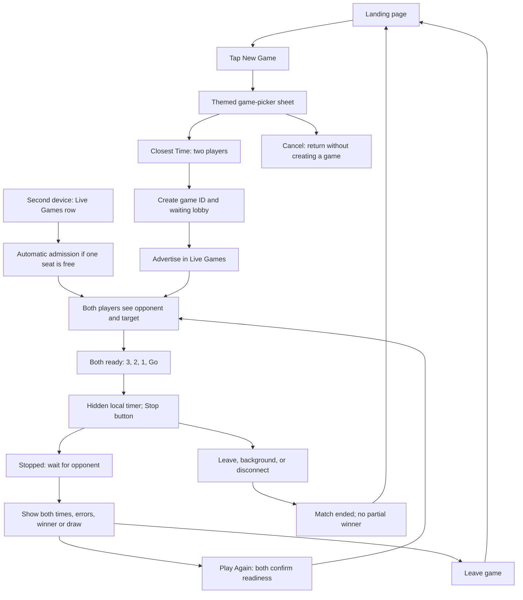
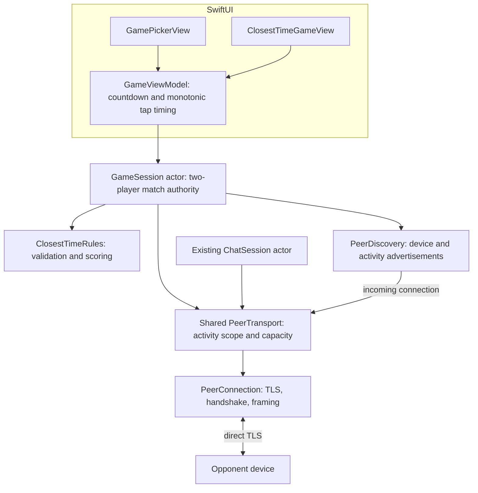

# Subway Lore PoC — Closest Time Game Plan

## Goal

Add a nearby two-player game called **Closest Time**. New Game opens a themed game-picker sheet. Selecting Closest Time creates a lobby; a second rider joins from the Live Games card. Each player tries to stop a hidden timer as close as possible to the round's target time.

This document is a plan only. The existing chat implementation stays intact until game implementation is approved.

## Rules and proposed PoC defaults

- Exactly two players, connected directly over the existing TLS transport.
- The creator acts as the game authority for this match. No permanent car host is introduced.
- Each round randomly selects a whole-second target `x`, inclusive from **3 through 10 seconds**. The authority chooses it once and shares it with both players.
- Both players see the target before the round begins.
- Once both players are ready, each device displays **3 → 2 → 1 → Go** and starts its local timer.
- Elapsed time stays hidden while running. The player taps **Stop** when they think the target has elapsed. Holding the button is not required.
- Each player gets one Stop per round. Stop is disabled before Go and after a valid tap.
- Compare `abs(elapsedMilliseconds - targetSeconds * 1000)`. The smaller error wins. Equal errors at millisecond precision produce a draw.
- Reveal both elapsed times, both errors, and the outcome only after both players have stopped or timed out.
- A player who has not stopped after 20 seconds forfeits that round. If both time out, show no winner.
- Play Again starts a new ready check, round ID, and target. It does not silently restart the timer for the other player.
- Leaving, losing a player, or backgrounding during a round cancels the match. Show an explanation rather than declaring a winner from an incomplete round.
- Games are ephemeral for this PoC: no game history, score persistence, spectators, or host migration.

Random integer targets, hidden elapsed time, millisecond ties, and the 20-second timeout are proposed defaults for this implementation.

## UI flow



### Landing page

- Preserve the existing four-card layout and the discovery map's current 180-point height.
- Enable New Game and replace its Coming Soon subtitle with a short action label such as “Challenge a rider.”
- New Game opens a popup containing a list of supported games. Initially that list contains only Closest Time, with an icon, short explanation, and “2 players.”
- Live Games shows up to three rows, consistent with Live Chats. Each row includes game type, host name, and availability.
- Only waiting lobbies with a free seat are joinable. Full/playing games can appear with a clear status and disabled joining; there is no spectator mode.
- Creating a game happens only after selecting Closest Time. Opening or dismissing the picker does not create a lobby or connection.
- Use the app's dark background, rounded cards, orange game accent, and existing typography throughout.

### Game screen

- Waiting lobby: creator identity, “Waiting for another rider,” and Leave.
- Ready: target prominently displayed, both player names and ready indicators, Ready button.
- Countdown: large 3 / 2 / 1, target still visible, Stop disabled.
- Running: target, “Trust your timing,” and a large Stop button; no elapsed counter.
- Stopped: “Locked in,” no second attempt, opponent progress indicator without revealing the opponent's score.
- Results: each player's measured time and absolute error, clear winner/draw, Play Again and Leave.
- Interrupted: explain that the opponent left or the app moved to the background; provide return to landing.
- Provide accessible button labels and text outcomes; do not rely only on color or animation.

## Models

| Model | Fields / responsibility |
| --- | --- |
| `GameKind` | Codable enum, initially `.closestTime`; stable wire identifier and display metadata |
| `GameLobby` | `id`, `kind`, `hostPeerID`, `hostDisplayName`, creation time; stable identity for one match |
| `DiscoveredGame` | Lobby ID, game kind, host identity, advertiser endpoints, seat availability, current public phase |
| `GamePlayer` | Peer UUID, display name, ready state, connection state; at most two players including the local user |
| `ClosestTimeRound` | Round UUID, lobby UUID, target seconds, fixed two-player roster; validated target range |
| `TimingAttempt` | Lobby ID, round ID, player UUID, measured elapsed milliseconds or timeout; immutable after acceptance |
| `RoundOutcome` | Both attempts, each absolute error, winner UUID or draw/no-winner outcome |
| `GamePhase` | Idle, waiting, ready, countdown, running, submitted, results, ended |
| `GameSnapshot` | Lobby, players, current round, local phase/countdown, local attempt, published outcome, user-facing error |
| `GameSession` | Actor owning lobby/admission, round protocol, authority decisions, timeouts, and peer lifecycle |
| `ClosestTimeRules` | Pure validation and scoring functions, independently testable without Network or SwiftUI |
| `GameViewModel` | Main-actor published state, local monotonic timing, countdown and tap handling |

Keep all game models separate from `Chat`, `ChatMembership`, and `ChatMessage`. A game must not create a fake chat or appear in chat history.

## Shared networking boundary

The current transport takes a `Chat` and performs chat-specific admission. Generalize that boundary before adding the game so it can carry either activity without duplicating TLS/framing or changing chat persistence.

Introduce an `ActivityScope` / `ActivityDescriptor` with:

- Kind: chat or game.
- Stable activity UUID.
- Type-specific metadata: existing Chat metadata or GameLobby metadata.
- Admission policy: eight remote connections for chat, one remote opponent for a game.
- Scope validation for every application message.

Replace chat-only admission with versioned activity admission, or retain chat admission while adding an explicit parallel game admission path behind the same transport abstraction. Prefer the shared abstraction if it remains small and preserves existing chat tests.

One device has only one active network activity in this PoC. Browsing the picker changes nothing; creating or joining a game closes any active chat connections while retaining chat history. Returning to landing leaves the game. Game messages never enter ChatStore or history synchronization.



## Discovery and admission

- Keep advertising the existing persistent device UUID and profile name.
- Add bounded TXT fields for activity kind, lobby ID, game kind, host UUID, seat availability, and public lobby phase.
- Treat advertisements as hints. Confirm game type, host, scope, availability, and version after TLS establishment.
- Aggregate by lobby ID so each game has one row. The host advertises a waiting game; a joined guest must not become a replacement host if the creator disappears.
- Automatically admit the first compatible opponent and reserve that seat during admission. Reject a racing third device with “Game is full.”
- A rejected device must not replace the existing opponent or mutate the round roster.
- Once full or playing, update the advertisement so other riders see that it cannot be joined.
- On leaving/end, remove game advertisement fields while continuing general rider discovery.
- Do not reconnect an interrupted in-progress round and resume an old timer. A new match or explicit fresh round is required.

## Round protocol and timing

Use activity-scoped, versioned messages with stable game ID, round ID, and sender identity:

1. Game admission request, accepted lobby/roster, or structured rejection.
2. `roundPrepared`: authority publishes round ID, validated target, and both player UUIDs.
3. `playerReady`: each player confirms this exact round once.
4. `roundStart`: authority sends once after both players are ready.
5. `timingAttempt`: each player submits one result for that round.
6. `roundResult`: authority validates both attempts, computes the outcome, and publishes both records.
7. `rematchRequest` / a new `roundPrepared`: reset readiness; each player must opt into the next round.
8. `gameEnded`: explicit reason for leaving or interruption where the connection is still available.

```mermaid
sequenceDiagram
    autonumber
    participant A as Creator / authority
    participant B as Opponent

    A->>A: create lobby and advertise one free seat
    B->>A: TLS plus game admission request
    A->>A: reserve opponent seat
    A->>B: admission accepted, canonical lobby and roster
    A->>B: roundPrepared with target x in 3...10
    A->>A: creator taps Ready
    B->>A: playerReady for this round
    A->>B: roundStart
    Note over A,B: Each device runs its own 3-2-1 countdown
    A->>A: Go: capture monotonic start instant
    B->>B: Go: capture monotonic start instant
    A->>A: Stop: capture elapsed duration once
    B->>A: timingAttempt with elapsed milliseconds
    A->>A: validate roster, round ID, bounds, duplicate attempts
    A->>A: compare absolute errors against target
    A->>B: roundResult with both attempts and outcome
    Note over A,B: Both show the same result; next round requires readiness again
```

Each player measures their own interval from their local Go cue to their local Stop tap using a monotonic clock. Do not compare device wall-clock timestamps or infer elapsed time from message arrival. Different network arrival times may shift when devices begin, but do not change either player's measured interval.

Capture the Stop instant immediately on the UI's tap handler, before awaiting actors or network sends. Store the start instant at the transition to Go. Rendering and scheduling introduce normal device latency; this PoC does not promise laboratory-grade timing accuracy.

Reject invalid targets, negative/non-finite durations, attempts outside the permitted round window, unknown players, and stale/mismatched round IDs. Repeated identical readiness/attempt/result messages are idempotent. A conflicting second attempt cannot overwrite the first. Accept authoritative control messages only from the declared host and recompute the published outcome locally before showing it.

Add a result-delivery timeout and an acknowledgement/retry path for final results so one screen does not remain waiting forever after the other finishes. Leave or generation changes cancel countdown, attempt timeout, result timeout, and rematch work.

The client reports its measured duration. The shared-certificate PoC does not provide cheat-proof timing or cryptographic proof of the original tap.

## Implementation steps

1. **Rules and models:** Add game kind/lobby/round/attempt/outcome types and pure validation/scoring. Test target boundaries, ties, timeouts, invalid input, and immutable attempts.
2. **Activity transport:** Generalize transport scope and admission capacity while preserving chat creation, joining, reconnection, and history synchronization. Add scope-isolation regression tests and version compatibility checks.
3. **Game discovery:** Add bounded game advertisements, Live Games aggregation, single-seat reservation, and full/unavailable rejection.
4. **Game session:** Implement host authority, ready check, countdown/start messages, result submission, outcome validation, result acknowledgement, and rematch.
5. **Themed UI:** Enable New Game, build the picker and game screen, and populate up to three Live Games rows. Keep the existing landing layout.
6. **Lifecycle handling:** End interrupted matches, cancel all timers/tasks on leave, and continue rider discovery. Preserve unrelated chat history.
7. **Verification and docs:** Run core tests and app build; verify the two-device flow and a third-device rejection; update system diagrams with game components and protocol.

## Acceptance checks

- Opening/dismissing the picker creates nothing; selecting Closest Time creates one advertised lobby.
- Both 3-second and 10-second targets work, and no target outside the inclusive range is accepted.
- Two nearby players join one lobby automatically; a racing third device is rejected.
- Neither player can stop during the countdown or submit twice.
- Both screens display the same target, attempts, errors, and outcome.
- Equal errors produce a draw; one missing attempt forfeits; both missing attempts produce no winner.
- Injected network delay does not alter measured elapsed durations.
- Duplicate/stale messages and an old round's delayed attempt cannot alter the current round.
- Result delivery failures end in a visible retry/interruption state, not an endless waiting screen.
- Rematch uses a fresh round ID and both players explicitly become ready again.
- Leaving/backgrounding/disconnecting cancels the round and clears the live advertisement.
- Existing chat tests continue passing; no game appears in chat history or receives chat messages.
- Run scoring/state tests without launching the app. Actual timing interaction, admission races, backgrounding, and TLS behavior require device verification.
