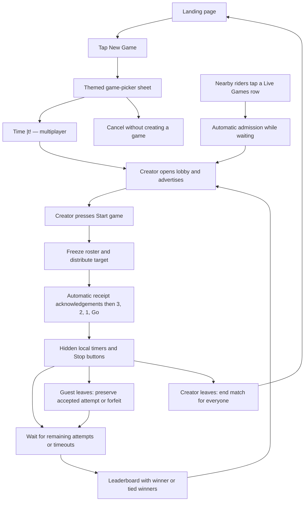
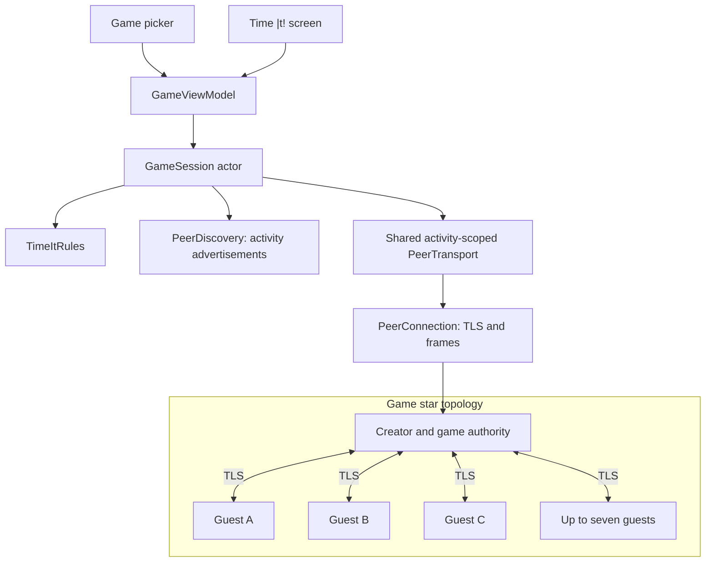

# Subway Lore PoC — Time |t! Game Plan

## Goal

Add a nearby multiplayer game with the exact display name **Time |t!**. New Game opens a themed game-picker sheet. Selecting Time |t! creates a lobby; other riders join from Live Games. The creator presses Start to begin a round. Each player watches a running timer and tries to stop exactly at the shared target time; the smallest timing error wins.

The initial implementation follows this design. Core rules and protocol tests run with `make test-core`; multiplayer timing and lifecycle behavior still require physical-device verification.

## Rules and proposed PoC defaults

- Support multiple players, with a minimum of two including the creator.
- Maximum **eight players total**: creator plus seven guests.
- The creator participates and acts as authority for this game. No permanent car host is introduced.
- Each round randomly selects a whole-second target `x`, inclusive from **1 through 6 seconds**. The creator's device chooses it once.
- Players can join automatically while the lobby is waiting and space remains.
- Only the creator sees an enabled **Start game** button. It is enabled once at least two players are admitted and connected.
- Guests see “Waiting for the creator to start.” There is no manual Ready button.
- Starting freezes the roster, closes admission, and distributes the round ID and target. Devices acknowledge receipt automatically before the countdown starts.
- Every participating device displays **3 → 2 → 1 → Go**, then starts its local timer.
- Elapsed time is visible while running. The player taps **Stop** at the target; no holding is required. The display shows hundredths, and scoring uses the captured milliseconds.
- Each player has one attempt. Stop is disabled before Go and after the first valid tap.
- Score each valid attempt using `abs(elapsedMilliseconds - targetSeconds * 1000)`. The smallest error wins.
- Equal smallest errors at millisecond precision produce joint winners. Display all tied winners.
- Reveal the leaderboard only when every frozen-roster player has submitted, timed out, or disconnected.
- A player who has not stopped after 20 seconds forfeits the round. If everyone forfeits, show no winner.
- After results, return to a lobby where players may leave and new guests may join. Only the creator starts the next round, with a fresh round ID and target.
- A guest leaving or backgrounding forfeits that round; the other players continue. A submitted attempt remains eligible if already accepted before disconnect.
- The creator leaving, backgrounding, or losing availability ends the match for everyone. There is no host migration or mid-round timer resumption.
- Verified completed rounds are saved locally for per-game leaderboards and head-to-head records. Spectators, tournaments, and global score synchronization remain outside this PoC.

Current defaults are integer targets from 1–6 seconds, visible elapsed time, eight-player capacity, millisecond ties, and a 20-second timeout. The name, multiplayer participation, and creator-controlled Start are required behavior.

## UI flow



### Landing and game picker

- Preserve the four-card landing layout and the current 180-point discovery map height.
- Enable New Game, with an action subtitle such as “Play with nearby riders.”
- The picker initially lists only **Time |t!**, an icon, a short explanation, and “Multiplayer.”
- Opening or dismissing the picker creates no lobby or network connection.
- Live Games shows at most three rows with game name, creator name, player count/capacity, and waiting/playing/full status.
- Waiting lobbies with a free seat can be joined. Playing or full rows are not joinable; there is no spectator mode.
- Match the app's dark background, rounded cards, typography, and orange game accent.

### Game screen

- Lobby: creator identified, complete player list, capacity, Leave, and creator-only Start game.
- Guests: “Waiting for the creator to start.”
- Preparing: show target and “Starting…” while protocol acknowledgements complete.
- Countdown: large 3 / 2 / 1; target remains visible and Stop is disabled.
- Running: target, a visible monotonic elapsed counter, and a large Stop button.
- Submitted: “Locked in,” no second attempt, and a count of players still timing.
- Results: ranked player names, elapsed times, absolute errors, forfeits, and winner or tied winners.
- Next round: lobby opens again; creator starts when satisfied with the roster.
- Creator interruption: explain that the game ended and offer return to landing.
- Use accessible text labels for phase, buttons, and outcome, not color alone.

## Models

| Model | Responsibility |
| --- | --- |
| `GameKind` | Codable enum, initially `.timeIt`; exact display name “Time &#124;t!” |
| `GameLobby` | UUID, kind, creator UUID/name, creation time, proposed capacity of eight |
| `DiscoveredGame` | Lobby identity, creator endpoint, public phase, player count and free seats |
| `GamePlayer` | Peer UUID, display name, connection and participation state |
| `TimeItRound` | Round/lobby UUIDs, validated target, immutable roster of admitted players |
| `TimingAttempt` | Lobby, round and player IDs; elapsed milliseconds or explicit forfeit; immutable once accepted |
| `RoundOutcome` | Ranked attempts/errors, set of winner UUIDs, no-winner outcome if none finish |
| `GamePhase` | Idle, lobby, preparing, countdown, running, submitted, results, ended |
| `GameSnapshot` | Lobby, players, phase, round, countdown, local attempt, leaderboard, errors |
| `GameSession` | Actor owning admission, host authority, round state, deadlines, and peer lifecycle |
| `TimeItRules` | Pure validation/ranking/tie functions, testable without networking |
| `GameViewModel` | Main-actor UI state, monotonic timer and immediate Stop capture |

Keep games separate from Chat, ChatMembership, ChatMessage, and ChatStore. A game must not create a fake chat or appear in chat history.

## Shared networking and topology

Generalize the current chat-specific transport boundary to an `ActivityScope` / `ActivityDescriptor` containing kind, stable UUID, typed metadata, admission policy, and message-scope validation. Reuse TLS, peer identity, framing, and duplicate-connection arbitration.

**Games use a star topology:** every guest connects only to the creator. Guests do not need connections to each other. The creator distributes roster, round state, progress, and results.



- Chat retains its current mesh topology and eight-peer bound.
- A game creator may connect to seven guests; a guest may connect only to the declared creator.
- Reject incoming guest-to-guest game connections.
- One device has one active network activity in this PoC. Creating/joining a game closes any active chat connections but preserves chat history.
- Browsing the game picker does not leave a chat or start a connection.
- Leaving returns to landing and continues general rider discovery.
- Introduce explicit protocol compatibility for the new activity/game messages and keep existing chat regression tests passing.

## Discovery and automatic admission

- Keep device UUID/name advertising and add bounded activity/game TXT fields.
- The creator advertises lobby ID, game kind, host UUID, phase, player count, and capacity.
- Group Live Games rows by lobby ID. Guests may discover the game but do not advertise themselves as its authority.
- Verify host identity, game kind, availability, and scope after TLS; Bonjour metadata is only a hint.
- Reserve each guest seat atomically before accepting admission. Concurrent joins must not exceed capacity or replace an admitted player.
- Creator Start and admission must be serialized: a join is either included in the frozen roster or rejected with “Round already starting.”
- Reject joins while preparing/counting down/running/submitted. Reopen admission after results when returning to the lobby.
- A guest disconnect updates the roster/count and availability. Do not replace a participant inside an ongoing round.
- Creator departure removes the live advertisement; guests do not become replacement hosts.

## Round protocol

Use versioned, activity-scoped messages with game ID, round ID, and sender UUID.

1. Admission request, accepted lobby/roster, or structured full/unavailable/incompatible rejection.
2. Lobby roster updates so every guest sees who has joined.
3. Creator-only Start: freeze the connected roster, choose the target, and publish `roundPrepared`.
4. Automatic `roundPreparedAck` from each roster guest; no user Ready action.
5. Creator publishes `roundStart` once all required acknowledgements arrive.
6. Players submit one `timingAttempt`; creator validates and broadcasts submission progress without revealing times.
7. Creator publishes `roundResult` when all roster entries have a result/forfeit.
8. Result acknowledgements and bounded retry/timeout prevent endless result-waiting screens.
9. Creator reopens the lobby between rounds and controls the next Start.
10. `gameEnded` communicates creator departure or explicit end where possible.

```mermaid
sequenceDiagram
    autonumber
    participant H as Creator
    participant A as Guest A
    participant B as Guest B

    A->>H: automatic admission request
    H->>A: accepted lobby and roster
    B->>H: automatic admission request
    H->>B: accepted lobby and roster
    H->>A: roster now includes H, A, B

    H->>H: creator presses Start
    H->>H: freeze roster and choose target in 1...6
    H->>A: roundPrepared
    H->>B: same roundPrepared
    A->>H: automatic receipt acknowledgement
    B->>H: automatic receipt acknowledgement
    H->>A: roundStart
    H->>B: roundStart
    Note over H,B: Each device counts down locally, then measures its own interval
    A->>H: timingAttempt
    B->>H: timingAttempt
    H->>H: record creator's own attempt
    H->>H: rank all valid attempts by absolute error
    H->>A: leaderboard and winner IDs
    H->>B: same leaderboard and winner IDs
    A->>H: result acknowledgement
    B->>H: result acknowledgement
    Note over H,B: Return to lobby; only creator can start another round
```

Set a bounded preparation-acknowledgement deadline. If a roster guest drops or fails to acknowledge before countdown, abort preparation, update the lobby, and let the creator start again. Do not silently start different rosters on different devices.

## Timing, ranking, and interruptions

- Measure each player's interval from their local Go cue to their local Stop using a monotonic clock.
- Capture Stop immediately in the UI tap handler before awaiting actors/network sends.
- Do not compare wall-clock timestamps or infer timing from packet arrival. Network delays may shift local start moments but must not alter measured durations.
- Accept one attempt for each frozen-roster UUID and round ID. Reject stale rounds, unknown players, invalid targets, invalid durations, and conflicting second attempts.
- Repeated identical attempts, starts, acknowledgements, and results must be idempotent.
- Only the declared creator can send authoritative round/roster/results messages. Guests recompute the leaderboard from published attempts before displaying the outcome.
- All players sharing the smallest error are winners; use peer UUID only to order otherwise tied leaderboard rows, never to break the win.
- Guest disconnect before an accepted attempt becomes a forfeit; other players continue. Accepted attempts are retained.
- Creator interruption ends the match. Guest backgrounding leaves the game; creator backgrounding ends it.
- Cancel local countdown, attempt timeout, preparation/result deadlines, and pending round work on leave or session-generation change.
- Client-reported timings are trusted in this PoC; it is not a cheat-proof competition.

## Implementation sequence

1. **Models/rules:** Add multiplayer roster, immutable attempts, ranking/ties/forfeits, validation, and tests.
2. **Activity transport:** Separate activity scope from Chat and support creator/guest connection policies without regressing chat.
3. **Discovery/admission:** Advertise lobbies, aggregate Live Games, reserve up to seven guest seats, and serialize joins against Start.
4. **Game session:** Implement creator-controlled Start, frozen roster, automatic preparation acknowledgements, attempts, progress, results, and next round.
5. **UI:** Add themed picker, lobby/player list, creator Start button, timer screen, multiplayer leaderboard, and live rows.
6. **Lifecycle:** Handle guest forfeits and creator termination, cancel old work, and preserve unrelated chat history.
7. **Verification/docs:** Run core tests/app build and test with at least three physical devices.

## Acceptance checks

- The picker and live rows use the exact name “Time |t!”.
- Opening/dismissing the picker creates no game; selecting the game creates one lobby.
- At least three devices join the same lobby; guests connect only to the creator.
- Only the creator can start; fewer than two players disables Start.
- Joining does not start the round automatically.
- Concurrent joins and creator Start produce one agreed frozen roster.
- The eight-player limit includes the creator; excess joins are rejected without displacing anyone.
- Targets include both 3 and 10 and reject values outside the range.
- Stop is unavailable before Go and after submission.
- Every device displays the same roster, target, leaderboard, and winner set.
- Equal best errors produce joint winners; forfeits never beat valid attempts; everyone forfeiting yields no winner.
- Network delay does not change locally measured duration.
- A guest dropping does not terminate everyone else's round; the creator dropping does.
- Delayed old-round messages cannot mutate a new round; no in-progress timer is resumed after reconnect.
- Results have bounded acknowledgement/retry behavior.
- Between rounds, guests can join/leave and only the creator starts again.
- Chat/history tests keep passing and no game message leaks into a chat.
