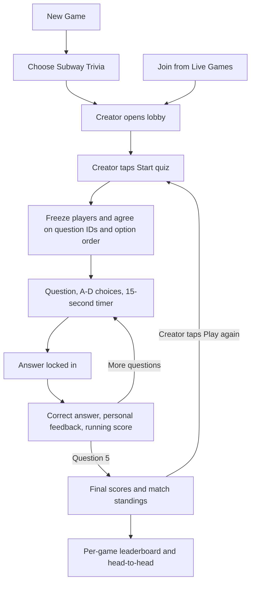

# NYC Subway Trivia

Status: implemented; physical-device verification remains.

## Gameplay

- Full name: **NYC Subway Trivia**. Picker, live rows, navigation, and leaderboard use **Subway Trivia**.
- Offline bank of the user's 100 questions in five categories, each adapted to one correct answer among four A–D choices.
- Two to eight players, including the creator. The creator presses Start quiz.
- Each match selects 5 unique questions and shuffles their options. Everyone receives the same questions and A–D order.
- Each question allows 15 seconds. One immutable answer per player; timeout earns zero.
- Correct answer: one point. Wrong answer: zero. No speed bonus or penalty.
- Reveal the answer once everyone has answered or timed out, then hold the reveal for at least three seconds.
- After question 5, rank by total correct answers. Equal scores share placement and first-place wins.
- Creator chooses Play again for a new match with a fresh ID and random selection. Questions prioritize each player's saved unseen-question history.
- Admission is closed throughout the quiz, including answer reveals. New players can join after final results.
- Leaving/backgrounding forfeits the match; accepted answers remain in the record and remaining questions receive no answer. Departed players have no final placement.
- Creator departure/backgrounding ends the quiz; incomplete quizzes do not affect saved standings. No host migration or mid-match rejoin.

## UI flow



The compact picker uses distinct artwork and color accents for each game, short taglines, and a 440-point initial sheet height. It scrolls for larger text. Landing page discovery height, compact highlighted live rows, and three-row limit remain unchanged.

## Models and integration

| Type | Responsibility |
| --- | --- |
| `GameKind.subwayTrivia` | Discovery, picker, routing, and separate leaderboard selection |
| `TriviaQuestion` / `TriviaQuestionBank` | Stable IDs 1–100, category, prompt, four options, correct option; bank version 1 |
| `TriviaCard` | Question ID and shuffled option order shared by every player |
| `TriviaQuestionHistory` / `TriviaQuestionHistoryStore` | Per-player seen IDs, shared during admission and after each question; saved atomically between sessions |
| `TriviaRound` | Unique match ID, lobby ID, bank version, frozen players, 5 cards |
| `TriviaAnswer` | Match ID, question index, author UUID, original option ID or timeout |
| `TriviaQuestionResult` | Complete roster's immutable answers to one question |
| `TriviaOutcome` | All 5 question results and departed players; scores and placements derived locally |
| `TriviaRules` / `TriviaMatch` | Pure validation, answer admission, progression, forfeits, scoring |
| `TriviaSession` | Game-specific actor; scoped transport lease, admission, preparation, deadlines, reveals, results |
| `TriviaSnapshot` / `TriviaGameView` | Lobby, timer, selection, reveal, scores and errors |

Reuse `GameLobby`, `GamePlayer`, `ActivityCoordinator`, TLS star topology, `GameResultsStore`, `CompletedRound`, `GameStandings`, and `StandingsCard`. Time |t! keeps its existing session/rules and screen. `AppViewModel` routes each game kind to its session. One activity owns connections at a time; stale leases and callbacks cannot close a replacement activity.

## Multiplayer lifecycle

```mermaid
sequenceDiagram
    participant H as Creator
    participant G as Guest
    participant S as Local results stores
    G->>H: Secure game admission
    H->>G: Connected roster
    G->>H: Saved seen-question IDs for this bank version
    H->>H: Prefer questions unseen by every player
    H->>G: Prepare bank version, match ID, players, question IDs, choice orders
    G->>G: Validate against bundled bank
    G->>H: Prepared acknowledgement
    loop 5 questions
        H->>G: Begin question index
        Note over H,G: Local visible 15-second timer; creator allows 2 seconds transport grace
        G->>H: Selected original option ID, or timeout
        H->>G: Answered-player IDs, no selections revealed early
        H->>H: Freeze answers when complete or after 17 seconds
        H->>G: Answer reveal and full question results
        G->>G: Validate roster, IDs, options and own accepted answer
        G->>H: Reveal acknowledgement
        Note over H,G: Minimum 3-second review before advancing
    end
    H->>S: Save completed 5-question match
    H->>G: Complete outcome
    G->>G: Verify outcome matches all previously received reveals
    G->>S: Save derived placements
    G->>H: Result acknowledgement after save
```

Preparation has a 10-second deadline. Guests time out admission after 20 seconds and active creator updates after 30 seconds. Answer reveals retry every two seconds after the initial three-second display, up to four retries, then end if a connected player never acknowledges. Final results retry five times at two-second intervals. No unbounded waits; timers cancel when the activity ends.

Packets use the existing game-scoped protocol v3 envelope with a new `GameEvent.trivia(TriviaEvent)` payload. Updated clients recognize the new advertised game kind; older clients ignore unknown game advertisements. All trivia players require the same bundled bank version. The question bank is bundled source data; gameplay makes no web requests. This PoC trusts the creator and is not a cheating-resistant system.

## Persistent scoring

Save one `CompletedRound` for the entire 5-question quiz, rather than one win per question. Store game kind `.subwayTrivia`, lobby ID, match ID, participants, derived placements, and `correctAnswers` / `questionCount` measurements.

Reuse the existing atomic `game-results-v1.json` file. Duplicate outcomes are idempotent; conflicting outcomes cannot replace saved records. First-place ties count as shared wins. Head-to-head compares final placement, including when neither player wins the overall quiz. Time |t! and trivia standings remain separate.

Only completed outcomes received by that device are saved. There is no cross-device stats synchronization or history for late joiners. A save failure is visible and a repeated result retries saving before acknowledgement.

## Question rotation

Save each player's seen question IDs in `trivia-question-history-v1.json`, keyed by stable peer UUID and bank version. Record a question when it begins, including in an interrupted match, rather than marking all prepared questions as seen. Guests send their saved history to the creator on connection and update it as questions begin. Start waits for all participant histories.

Selection shuffles candidates, prefers the fewest players who have already seen a question, and prevents duplicate questions within the same match. A player's cycle resets only after all 100 distinct IDs have been seen. Working histories update after each selection, so a five-question session can finish an old cycle and begin a new one.

Players with matching histories exhaust the bank across 20 five-question sessions before any repeat. New groups use questions unseen by everyone whenever possible. With incompatible histories there may be no shared unseen question; universal no-repeat guarantees are then impossible while showing everyone the same quiz. Choose questions repeated for the fewest players rather than silently resetting anyone's history.

## Content notes

Open-ended and yes/no questions are rephrased as four-choice, single-answer questions. Prompts asking for any valid route select one route and use three invalid alternatives. The original five supplied “rounds” are content categories, rather than five mandatory gameplay rounds.

Question 32 specifies nights/weekends to preserve the supplied F answer while accounting for the weekday F/M swap. [Roosevelt Island Operating Corporation service description](https://www.rioc.ny.gov/community/transportation/subway). Question 99 retains “rolling stock,” consistent with the [New York Transit Museum](https://www.nytransitmuseum.org/meet-the-arnines/). Other content is adapted from the supplied bank; this is not a live service advisory and a full editorial audit is separate from implementation.

## Validation

- Bank: exactly 100 stable IDs, five categories, four distinct nonempty choices per question.
- Rules: valid rosters/choice permutations, 5 unique questions, immutable answers, stale IDs, ties, timeouts, departures, and independent game-kind scoring.
- Rotation: 100 unique questions before repetition for a stable group, common-unseen priority for mixed groups, cycle boundaries, incompatible histories, and persistence across restart.
- Protocol: all trivia events round-trip through JSON/framing; an eight-player, five-question outcome fits the transport's 64 KB payload bound.
- Session tests: a complete three-device match with identical stored outcomes, duplicate and stale messages, fresh replay IDs, admission lock, timer expiry, creator/guest departure, and activity switching.
- Build the native iOS app/tests. Physical devices still need discovery, latency, interaction, backgrounding, and multiplayer validation.
